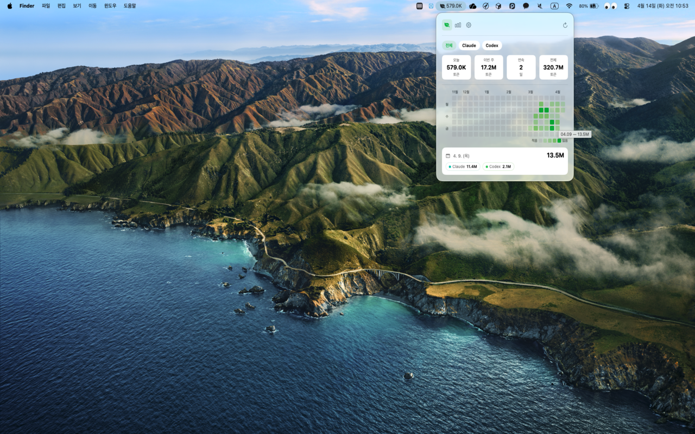

# Token Jandi


[](https://github.com/wheon06/token-jandi/blob/main/LICENSE)
[](https://github.com/wheon06/token-jandi)
[](https://developer.apple.com/swift/)
[](https://github.com/wheon06/token-jandi/actions/workflows/ci.yml)


## Introduction

Check your Claude Code and Codex token usage easily from the macOS status bar.

## Preview 👀


## What's New in 1.5.0

- Tabs split by question: Usage (how much you used) and Limits (how much is left).
- Heatmap, daily and monthly charts now live together on the Usage tab.
- The Limits tab shows each agent's plan next to its limits.
- The popover reopens on the tab you last used.

See [RELEASE_NOTES.md](./RELEASE_NOTES.md) for the full list.

## Data Accuracy

Token Jandi reads Claude Code and Codex usage from local files on the current Mac. Codex compresses old sessions into `~/.codex/archived_sessions` and eventually deletes the original logs; archived sessions are decoded and counted exactly, while threads that only remain in Codex's thread database are counted from their stored total and marked as an estimate in the app. If you use the same Claude or Codex account on multiple devices, usage from other devices may not appear in this app.

## Claude limits

Claude Code hands its 5-hour / 7-day usage (`rate_limits`) only to the [status line](https://code.claude.com/docs/en/statusline) script. Turn on Settings → Claude limits and Token Jandi installs a tiny bridge script (`~/.claude/token-jandi-statusline.sh`) and points `statusLine` in `~/.claude/settings.json` at it. Your previous status line keeps running after the bridge, a backup of `settings.json` is kept in `~/.claude/token-jandi/`, and turning the switch off restores the previous setting. The cards appear after the next Claude Code response. `rate_limits` is only provided on claude.ai Pro / Max plans or behind a Claude apps gateway with a spend limit.

## Requirements

- `Token Jandi` is written in Swift (Swift 5 language mode, Xcode 26)
- Compatible with macOS 14 +

## Development

```bash
xcodebuild test -project token-jandi.xcodeproj -scheme token-jandi -destination 'platform=macOS'
```

## Releasing

```bash
scripts/release.sh 1.5.0
```

Sets the version, runs the tests, uploads the Mac App Store build to App Store Connect, submits it for review, then tags `v1.5.0` and pushes it. The tag triggers a workflow that publishes the GitHub release from `RELEASE_NOTES.md`, so the App Store, the tag and the release always carry the same version.

Before running, write the version's section in `RELEASE_NOTES.md`, update "What's New" above, and write the App Store "What's New" text in `store/whats-new/<locale>.txt`. Submitting for review needs an App Store Connect API key; see the header of `scripts/release.sh`.

## Install

### Mac App Store

[Download Token Jandi on the Mac App Store](https://apps.apple.com/kr/app/token-jandi/id6761585375?mt=12)

## License 
`Token Jandi` is available under the MIT license. See the LICENSE file for more info.
